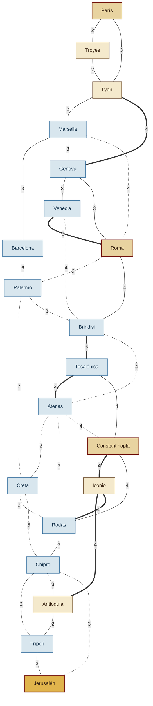

# TPO Programación III — La Ruta del Temple

Sistema en Spring Boot + Neo4j que implementa los algoritmos de la materia sobre
un dominio propio: **las rutas del Mediterráneo en el año 1129**, cuando un
mensajero de la Orden del Temple viaja desde una ciudad de Occidente hasta
Jerusalén.

## Integrantes

| Nombre completo | Usuario de GitHub |
|---|---|
| Juan Zeljkovich | [@Zelcito](https://github.com/Zelcito) |
| Marco Sobrido Alvano | [@M4RQUIT0S](https://github.com/M4RQUIT0S) |
| Santiago Ohoka | [@sohoka1101](https://github.com/sohoka1101) |

---

## Dominio elegido (hito 3)

### En una frase

> **La ruta entre Venecia y Brindisi cuesta 4 jornadas de viaje.**

Un peregrino templario parte de una ciudad de Occidente, tiene que entregar
cartas en tres encomiendas de la Orden y llegar a Jerusalén. Cada ruta entre
dos ciudades tiene un costo en **jornadas**, y antes de salir tiene que elegir
qué provisiones cargar en una mochila con capacidad limitada.

### Qué es cada cosa

| Concepto | En el dominio | En el modelo del scaffold |
|---|---|---|
| **Nodo** | Una **ciudad** del Mediterráneo de 1129, ubicada en su latitud y longitud reales | `Nodo` — `id` (código de 3 letras), `nombre`, `tipo` |
| **Tipo de nodo** | `CAPITAL`, `PUERTO`, `CIUDAD` o `DESTINO` (Jerusalén) | `Nodo.tipo` |
| **Arista** | Una **ruta** histórica entre dos ciudades: por camino, por mar o por montaña | `Conexion` (relación `CONECTA`) |
| **Costo de la arista** | **Jornadas de viaje** (días), números enteros positivos | `Conexion.costo` |
| **Ítem** | Una **provisión** para la mochila (comida, agua, objetos de fe, armas) | `Item` — `peso`, `valor` |
| **Peso del ítem** | Lo que ocupa en la mochila, en **kilogramos** | `Item.peso` |
| **Valor del ítem** | Cuántas **jornadas de víveres** aporta | `Item.valor` |

**Unidad del costo: jornadas.** Una jornada es un día de viaje. Todas las aristas
tienen costo entero entre 2 y 7, y no hay costos negativos ni cero, así que
Dijkstra es aplicable sin restricciones.

### El grafo es no dirigido

Las rutas se recorren en los dos sentidos con el mismo costo: ir de Venecia a
Brindisi cuesta lo mismo que volver. Al cargar el dominio en Neo4j (hito 4) cada
ruta se guarda en los dos sentidos, o se carga el grafo con `cargar(false)`, para
que DFS, BFS y Dijkstra la vean desde ambos extremos.

### Por qué este dominio sirve para todos los algoritmos

La consigna pide responder tres preguntas antes de elegir el dominio:

1. **¿Qué es una arista y qué número tiene encima?** Una ruta entre dos ciudades,
   con su costo en jornadas: *"la ruta entre X e Y cuesta N jornadas"*.
2. **¿Tiene sentido buscar el camino más barato pasando por nodos intermedios?**
   Sí, es el centro del dominio: de París a Jerusalén no hay ruta directa, hay que
   elegir por qué ciudades pasar. El camino mínimo cuesta **26 jornadas**, por
   ejemplo París → Lyon → Marsella → Roma → Brindisi → Atenas → Rodas → Chipre → Jerusalén.
3. **¿Hay algo que seleccionar bajo una restricción de capacidad?** Sí: las
   provisiones de la mochila, que tiene **15 kg** de capacidad.

No es un dominio bipartito: las ciudades se conectan entre sí y hay caminos de
cualquier ciudad a cualquier otra pasando por intermedias.

Cómo encaja cada algoritmo:

| Algoritmo | Pregunta del dominio |
|---|---|
| BFS / DFS | ¿A qué ciudades llego desde acá? ¿Cuál es la ruta con menos etapas? |
| Dijkstra | ¿Cuál es la ruta de menos jornadas hasta Jerusalén? |
| Prim / Kruskal | ¿Qué red mínima de rutas conecta las 20 ciudades? (costo total 53 jornadas, 19 rutas) |
| Floyd-Warshall | ¿Cuántas jornadas hay entre cada par de ciudades? |
| Greedy / Mochila 0/1 (PD) | ¿Qué provisiones cargo en 15 kg para tener la mayor cantidad de jornadas de víveres? |
| QuickSort / MergeSort | Ordenar las provisiones por peso, valor o valor/peso |
| Backtracking | Todas las rutas simples a Jerusalén que no superen N jornadas ni M etapas |
| Branch & Bound | Repartir las provisiones entre **k mulas de carga** minimizando la carga de la más cargada |

### Diagrama del grafo

20 ciudades y 36 rutas. Línea continua: camino · línea punteada: mar · línea
gruesa: montaña. El número sobre cada línea es el costo en jornadas.



### Ciudades (nodos)

| Id | Ciudad | Tipo | Latitud | Longitud |
|---|---|---|---|---|
| PAR | París | CAPITAL | 48.86 | 2.35 |
| TRO | Troyes | CIUDAD | 48.30 | 4.08 |
| LYO | Lyon | CIUDAD | 45.76 | 4.84 |
| BCN | Barcelona | PUERTO | 41.39 | 2.17 |
| MRS | Marsella | PUERTO | 43.30 | 5.37 |
| GEN | Génova | PUERTO | 44.41 | 8.93 |
| VEN | Venecia | PUERTO | 45.44 | 12.33 |
| ROM | Roma | CAPITAL | 41.90 | 12.50 |
| PAL | Palermo | PUERTO | 38.12 | 13.36 |
| BRI | Brindisi | PUERTO | 40.63 | 17.94 |
| TES | Tesalónica | PUERTO | 40.64 | 22.94 |
| ATE | Atenas | PUERTO | 37.98 | 23.73 |
| CON | Constantinopla | CAPITAL | 41.01 | 28.98 |
| ICO | Iconio | CIUDAD | 37.87 | 32.49 |
| CRE | Creta | PUERTO | 35.34 | 25.13 |
| ROD | Rodas | PUERTO | 36.43 | 28.22 |
| CHI | Chipre | PUERTO | 34.68 | 33.04 |
| ANT | Antioquía | CIUDAD | 36.20 | 36.16 |
| TRI | Trípoli | PUERTO | 34.43 | 35.85 |
| JER | Jerusalén | DESTINO | 31.77 | 35.21 |

### Rutas (aristas)

| Origen | Destino | Jornadas | Terreno |
|---|---|---|---|
| París | Troyes | 2 | camino |
| París | Lyon | 3 | camino |
| Troyes | Lyon | 2 | camino |
| Lyon | Marsella | 2 | camino |
| Lyon | Génova | 4 | montaña (Alpes) |
| Marsella | Barcelona | 3 | camino |
| Marsella | Génova | 3 | camino |
| Barcelona | Palermo | 6 | mar |
| Marsella | Roma | 4 | mar |
| Génova | Venecia | 3 | camino |
| Génova | Roma | 3 | camino |
| Venecia | Roma | 3 | montaña (Apeninos) |
| Roma | Palermo | 3 | mar |
| Roma | Brindisi | 4 | camino (Vía Apia) |
| Venecia | Brindisi | 4 | mar |
| Palermo | Creta | 7 | mar |
| Palermo | Brindisi | 3 | mar |
| Brindisi | Tesalónica | 5 | montaña (Vía Egnatia) |
| Brindisi | Atenas | 4 | mar |
| Tesalónica | Atenas | 3 | montaña |
| Tesalónica | Constantinopla | 4 | camino |
| Atenas | Creta | 2 | mar |
| Atenas | Rodas | 3 | mar |
| Atenas | Constantinopla | 4 | mar |
| Constantinopla | Iconio | 4 | montaña |
| Constantinopla | Rodas | 4 | camino |
| Creta | Rodas | 2 | mar |
| Rodas | Chipre | 3 | mar |
| Iconio | Antioquía | 4 | montaña (Tauro) |
| Iconio | Rodas | 4 | montaña |
| Chipre | Trípoli | 2 | mar |
| Chipre | Antioquía | 3 | mar |
| Antioquía | Trípoli | 2 | camino |
| Trípoli | Jerusalén | 3 | camino |
| Chipre | Jerusalén | 3 | mar |
| Creta | Chipre | 5 | mar |

El terreno es descriptivo: el costo que usan los algoritmos es siempre el
número de jornadas de la tabla.

### Provisiones (ítems) y capacidad

La mochila tiene **15 kg** de capacidad.

| Provisión | Peso (kg) | Valor (jornadas) |
|---|---|---|
| Pan de centeno | 2 | 2 |
| Carne salada | 3 | 6 |
| Queso curado | 4 | 5 |
| Odre de agua | 2 | 4 |
| Vino aguado | 8 | 10 |
| Reliquia santa | 4 | 2 |
| Salterio | 2 | 2 |
| Espada | 5 | 3 |
| Ungüentos | 3 | 2 |

Este conjunto está elegido para que **greedy por valor/peso no dé el óptimo**:
greedy carga Carne salada, Odre de agua, Queso curado, Pan de centeno y Salterio
(13 kg, **19 jornadas**), mientras que el óptimo con programación dinámica es
Pan de centeno, Carne salada, Odre de agua y Vino aguado (15 kg, **22 jornadas**).

### Lo que no forma parte del dominio

Este proyecto tiene además un juego en el navegador (*La Ruta del Temple*) que
usa este mismo grafo. En el juego hay estaciones, puentes caídos, bloqueos y
eventos que cambian el costo de una ruta **durante una partida**. Eso es una capa
del juego: el grafo cargado en Neo4j, los tests, los cálculos a mano y los
ejemplos de `docs/ENDPOINTS.md` usan siempre los costos base de esta tabla.

---

## Uso de IA

- **Claude (Claude Code, Anthropic):** se usó para diseñar el prototipo del juego
  en HTML, para armar los datos del dominio (ciudades, rutas y provisiones) y para
  el diseño estético del README.
- **Claude (Claude Code, Anthropic):** se usó en el hito 4 como apoyo para pasar
  el dominio a `CargaInicial`, implementar BFS y DFS, sus tests y sus fichas en
  `docs/ENDPOINTS.md`.

---

## Arranque rápido

```bash
# 1. Levantar Neo4j (local o Aura) y exportar las credenciales
cp .env.example .env          # completar NEO4J_PASSWORD
export $(cat .env | xargs)

# 2. Compilar y ejecutar
./mvnw spring-boot:run

# 3. Verificar que la base responde
curl "http://localhost:8080/api/grafo/resumen"
# -> {"vertices":20,"aristas":36,"dirigido":false,"ids":["PAR","TRO",...]}

# 4. Probar un recorrido
curl "http://localhost:8080/api/grafo/bfs?origen=PAR"
# -> ["PAR","TRO","LYO","MRS","GEN",...,"JER"]

# 5. Probar un algoritmo sin implementar
curl "http://localhost:8080/api/grafo/prim?origen=PAR"
# -> 501 {"estado":"PENDIENTE","detalle":"Todavia no esta implementado: Prim"}
```

Al arrancar, `CargaInicial` carga La Ruta del Temple. Si la base todavía tiene
el grafo de ejemplo del scaffold (nodos A..H), lo borra y carga el dominio.

Si el paso 3 responde, la infraestructura está bien y todo lo que queda es
escribir algoritmos.

## Estructura

```
model/          Nodo, Conexion (arista con costo), Item
repository/     acceso a Neo4j — repositorios BLOQUEANTES, sin Mono/Flux
service/        Grafo (lista de adyacencia en memoria) y GrafoService (carga)
algorithm/      >>> ACÁ VA TODO EL TRABAJO <<<  ahora son stubs con TODO
controller/     endpoints ya cableados — NO poner lógica algorítmica acá
seed/           datos de ejemplo
```

## Endpoints

| Método | Endpoint | Algoritmo | Puntos |
|---|---|---|---|
| GET | `/api/grafo/resumen` | — (verificación) | — |
| GET | `/api/grafo/dfs?origen=PAR` | DFS | 2 (con BFS) |
| GET | `/api/grafo/bfs?origen=PAR` | BFS | |
| GET | `/api/grafo/dijkstra?origen=PAR&destino=JER` | Dijkstra | 3 (con Prim y Kruskal) |
| GET | `/api/grafo/prim?origen=PAR` | Prim | |
| GET | `/api/grafo/kruskal` | Kruskal | |
| GET | `/api/grafo/floyd` | Floyd-Warshall | 1 (con mochila 0/1) |
| GET | `/api/grafo/ucs?origen=PAR&destino=JER` | UCS | opcional |
| GET | `/api/seleccion/greedy?capacidad=15` | Greedy | 1 |
| GET | `/api/seleccion/dinamica?capacidad=15` | Mochila 0/1 con PD | 1 |
| GET | `/api/seleccion/quicksort?criterio=ratio` | QuickSort | 1 (con MergeSort) |
| GET | `/api/seleccion/mergesort?criterio=peso` | MergeSort | |
| GET | `/api/grafo/rutas?origen=PAR&destino=JER&costoMaximo=30` | Backtracking | 1 |
| GET | `/api/seleccion/repartir?contenedores=3` | Branch & Bound | 1 |

Los ids son los de la tabla de ciudades. Todos los endpoints de grafos cargan
el grafo como **no dirigido**: Neo4j guarda cada ruta una vez y el grafo en
memoria agrega la inversa.

## El grafo de ejemplo del scaffold

Era el grafo que traía la carga inicial antes del hito 4. Ya no se carga en
Neo4j, pero se deja como referencia porque `GUIA-TPO.md` verifica Dijkstra, Prim
y Kruskal contra él.

```
      4        3
  A ------ B ----- C
   \       |     / |  \
    \ 9    | 7  /2 |11 \
     \     |   /   |    \
      ---- C   D --+     E
                |  5    / \
             8  |      /10 \ 6
                F ----+     G
                 \ 3        | 4
                  H --------+
```

Aristas: A-B(4) A-C(9) B-C(3) B-D(7) C-D(2) C-E(11) D-E(5) D-F(8) E-F(6) E-G(10) F-H(3) G-H(4)

Está elegido a propósito para que el camino mínimo **no sea el directo**:
A→C cuesta 9 en línea recta, pero A→B→C cuesta 7. Si su Dijkstra devuelve 9,
la relajación de aristas está mal.

## Antes de entregar

- [ ] `./mvnw test` pasa
- [ ] no hay ninguna contraseña en el código ni en `application.properties`
- [ ] cada algoritmo implementado tiene al menos un test
- [ ] `docs/ENDPOINTS.md` documenta entrada y salida de cada endpoint
- [x] el README explica **qué dominio eligieron y qué representa el costo**

Ver `GUIA-TPO.md` para el paso a paso.
